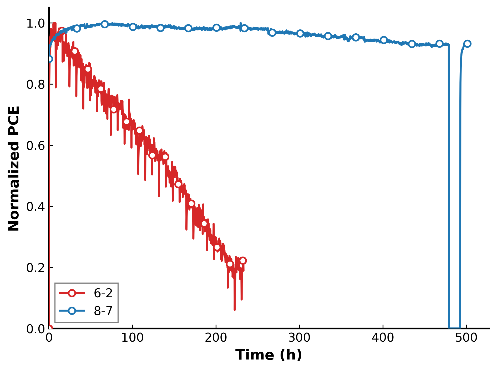
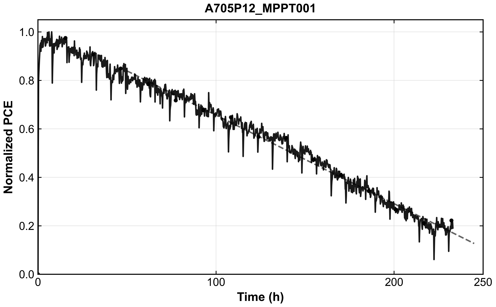
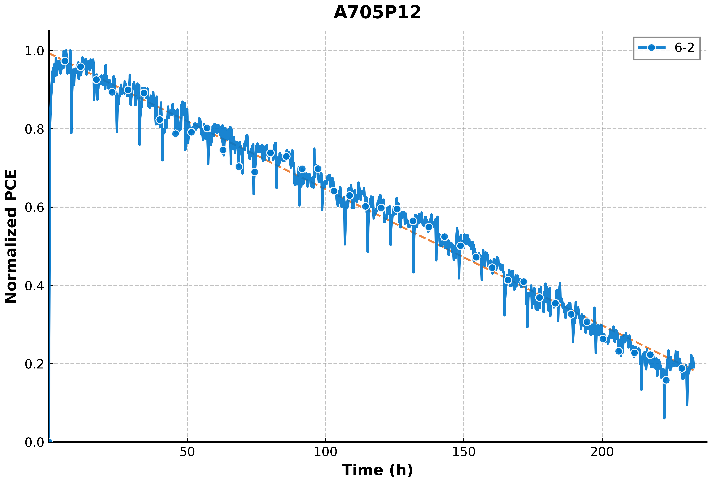
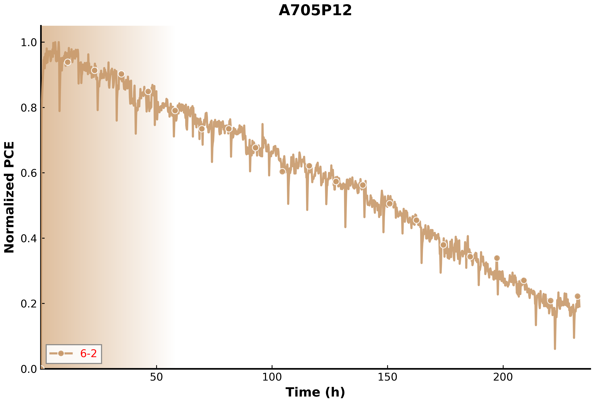

# Perovskite MPPT Curve Visualization Dataset

[English](README.md) | [简体中文](README_CN.md)

**Research question.** How can a vision model follow a perovskite stability curve through the line crossings, reference marks, and visual clutter common in scientific figures?

I turned **30 experimental MPPT device series** into **102 high-resolution figures** across four controlled visual challenges: auxiliary lines, line overlap, colored backgrounds, and multiple curves. The repository pairs each generated figure with processed measurements and plotting code, creating a concrete starting point for curve-tracing and figure-understanding studies.

<p align="center">
  
</p>

## Research Objective

The central task is to identify the **target degradation curve** despite visual elements that can obscure its path or make it easy to confuse with another line. The dataset focuses on four recurring challenges in scientific figures:

1. **Auxiliary lines are present:** grids, reference lines, or fitted trends appear near the target curve.
2. **The target and auxiliary lines overlap:** their crossings or shared segments make line identity ambiguous.
3. **The background varies in color:** gradients or colored regions reduce the reliability of simple color-based recognition.
4. **Multiple curves share one figure:** two or three series may cross or partially overlap, requiring the model to keep each curve distinct.

These challenges are represented through controlled renderings of perovskite MPPT time series. The intended learning path is to distinguish the target curve from non-target elements, follow it through difficult regions, and interpret the shape of the degradation curve. Model training and evaluation remain future work.

**Measurement meaning.** Each device's `Pmax` series is min–max scaled to 0–1. This preserves curve shape while removing absolute degradation magnitude; the figure y-axis label `Normalized PCE` refers to this scaling. Retention, T80, and lifetime require the original unscaled measurements.

## Data-to-Figure Workflow

```text
Experimental perovskite MPPT data
                │
                ▼
  Elapsed-time calculation and Pmax min–max scaling
                │
                ▼
         Processed curve CSV files
                │
                ├── assistline
                ├── assistline_overlap
                ├── colour
                └── multi
                         │
                         ▼
              Visual-learning image dataset
```

The dataset includes:

- 30 processed perovskite device datasets.
- 73,242 min–max scaled time-series points.
- 90 single-device figures across three categories.
- 12 multi-device figures in the fourth category.
- 102 high-resolution PNG figures in total.
- Scripts for preprocessing measurements and regenerating the visualizations.

## Four Figure Categories and Recognition Challenges

| Category | Figures | Recognition challenge | Rendering |
| --- | ---: | --- | --- |
| `figure/assistline/` | 30 | Identify the target curve when auxiliary elements are present | Single-device curve with markers, a reference grid, and a linear-fit line |
| `figure/assistline_overlap/` | 30 | Trace the target curve where it overlaps or crosses auxiliary lines | Single-device curve with gray dashed reference lines at every axis tick and an overlapping dashed linear-fit trend |
| `figure/colour/` | 30 | Recognize the curve despite a non-uniform colored background | Single-device curve with mixed filled and hollow markers over a brown-to-white gradient band covering the left part of the plot (up to 80 h or 22 % of the x-range, whichever is smaller) |
| `figure/multi/` | 12 | Keep multiple curves distinct through crossings and partial overlap | Two or three device curves shown in one plot |

The first three categories render individual experimental series. The `multi` category combines selected devices. The four categories isolate common visual ambiguities while retaining the underlying MPPT behavior.

## Repository Structure

```text
.
├── code/
│   ├── preprocess.py           # Converts raw perovskite MPPT exports to plotting metadata
│   ├── assistline.py           # Single-device plot with grid and a linear fit
│   ├── assistline_overlap.py   # Single-device plot with dashed references and trend overlay
│   ├── colour.py               # Single-device tan curve over a partial gradient band
│   ├── multi-2.py              # Two-device comparison plots
│   └── multi-3.py              # Two- and three-device comparison plots
├── data_csv/                   # 30 processed, flat CSV datasets
├── figure/
│   ├── assistline/             # Single-device figures with a fitted trend
│   ├── assistline_overlap/     # Single-device figures with grid/trend overlays
│   ├── colour/                 # Single-device color-style figures
│   └── multi/                  # Multi-device comparison figures
├── README.md                  # English
└── README_CN.md               # 简体中文
```

## Data Format

Each processed CSV contains the following columns:

| Column | Description |
| --- | --- |
| `ID` | Device or measurement identifier |
| `Figure` | Figure index |
| `Sub-figure` | Subfigure label |
| `Value_x` | Newline-separated elapsed-time values in hours |
| `Value_y` | Newline-separated `Pmax` values min–max scaled to 0–1 per device (shape only; see the note above) |
| `Legend` | Device-structure or dataset label |
| `X-label` | Label for the x-axis |
| `Y-label` | Label for the y-axis |
| `Title` | Optional figure title |

The included collection contains 73,242 time-series points across 30 device files. Measurement durations range from approximately 233 to 624 hours. A device identifier in `data_csv/` can be matched to figures with the same identifier under the single-device figure directories.

## Intended Use and Current Scope

- Develop visual-learning tasks that locate and follow the target curve in complex scientific figures.
- Study recognition under auxiliary lines, line overlap, background color variation, and multi-curve overlap.
- Support future training and evaluation of a perovskite degradation-curve-focused multimodal LLM / vision-language model.
- Compare degradation-curve shapes among single-device and multi-device MPPT plots (not degradation magnitude, because of the min–max scaling).

This release provides figures, processed measurements, and plotting scripts. A model-training study would add task-specific annotations and a device-grouped training/validation/test split so that renderings of one experimental curve stay in the same partition.

## Requirements

- Python 3.9 or later
- NumPy
- pandas
- Matplotlib

Install the dependencies in a virtual environment:

```bash
python3 -m venv .venv
source .venv/bin/activate
python -m pip install --upgrade pip
python -m pip install numpy pandas matplotlib
```

On Windows, activate the environment with `.venv\Scripts\activate`.

## Configuration

The scripts currently contain a `BASE_DIR` constant inherited from the original local workflow. Before running a script, change this value to the absolute path of your cloned repository:

```python
BASE_DIR = "/absolute/path/to/perovskite-mppt-curve-visualization-dataset"
```

The scripts read from and write to the following locations relative to `BASE_DIR`:

| Script | Reads | Writes |
| --- | --- | --- |
| `preprocess.py` | `原始数据/`, `器件结构.csv` | `<device-folder>/metadata_pv.csv` (directly under `BASE_DIR`) |
| `assistline.py` | `data/<device>/metadata_pv.csv` | `pub_style/<device>.png` |
| `assistline_overlap.py` | `data/<device>/metadata_pv.csv` | `assistline_overlap/<device>.png` |
| `colour.py` | `data/<device>/metadata_pv.csv` | `pub_style_all/<device>.png` |
| `multi-2.py`, `multi-3.py` | `data_csv/<device>.csv` | `multi_csv/<device1>_<device2>[_<device3>].png` |

Note that `preprocess.py` writes its output one level higher than the single-device scripts read it, so the device folders must be moved into `data/` (or the paths edited) before plotting. The output folders were renamed to the `figure/` subfolders when the repository was assembled.

The nested `data/` tree and the original instrument exports are not included. Each file in `data_csv/` has the same columns as a `metadata_pv.csv` file, so the single-device input layout can be recreated by copying `data_csv/<device>.csv` to `data/<device>/metadata_pv.csv`.

## Visualization Workflow

### Generate two-device comparisons

Edit the `PAIRS` list and, if necessary, `X_MAX_MAP` in `code/multi-2.py`, then run:

```bash
python code/multi-2.py
```

Each tuple in `PAIRS` must use a filename from `data_csv/` without the `.csv` extension. The committed list produces 8 figures.

### Generate two- and three-device comparisons

Edit the `PAIRS` list in `code/multi-3.py`, then run:

```bash
python code/multi-3.py
```

This script supports both two-item and three-item tuples and uses red, blue, and green curves. The committed list produces 8 figures; its first five pairs are the same as in `multi-2.py` and write to the same filenames, so whichever script runs last determines those five images.

Together the two committed `PAIRS` lists produce 11 distinct figures. `figure/multi/AY04P29_P101P04.png` is not produced by either list and must be added to `PAIRS` to be regenerated.

### Run the archived preprocessing workflow

`code/preprocess.py` expects two upstream inputs that are not included here:

- `原始数据/`: raw MPPT exports, either standard timestamp-column CSVs or supported instrument-specific CSVs.
- `器件结构.csv`: a mapping from device IDs to legend labels.

The script calculates elapsed time from the first timestamp, applies min–max scaling to `Pmax`, sets the y-label to `Normalized PCE`, and writes plotting metadata. Review its input/output paths before using it with new data.

### Generate single-device figures

After preparing the nested `data/<device>/metadata_pv.csv` layout, update `BASE_DIR` and run one of:

```bash
python code/assistline.py
python code/assistline_overlap.py
python code/colour.py
```

The committed files in `figure/assistline/` carry a `_Control_PCE` suffix (for example `A705P12_MPPT001_Control_PCE.png`) from an earlier version of `assistline.py`; the current script writes `<device>.png`.

## Examples of the Four Figure Categories

| `assistline` | `assistline_overlap` |
| --- | --- |
|  |  |
| `colour` | `multi` |
|  |  |

## Reproducibility and Dataset Notes

- All plotting scripts use Matplotlib's `Agg` backend and can run without a graphical display.
- Arial is requested for several styles; Matplotlib falls back to an available sans-serif font when Arial is unavailable.
- The plotting scripts sort samples by elapsed time and pair `Value_x` and `Value_y` entries up to their shared length.
- The preprocessor uses min–max scaling: `(Pmax - min(Pmax)) / (max(Pmax) - min(Pmax))`. Absolute power and retention relative to the initial value are not preserved.
- Generated images are high resolution and may require additional memory when processing many devices.
- Multiple figure styles may originate from the same underlying experimental curve. Treat them as related samples when designing machine-learning splits.
- The generated figures are intended for visual-learning and scientific-visualization research; they are not device-lifetime certification results or figures extracted from papers.

## License and Data Use

Reuse terms for the code and experimental data are being established. Check the source-data rights before redistributing the measurements or generated figures.
