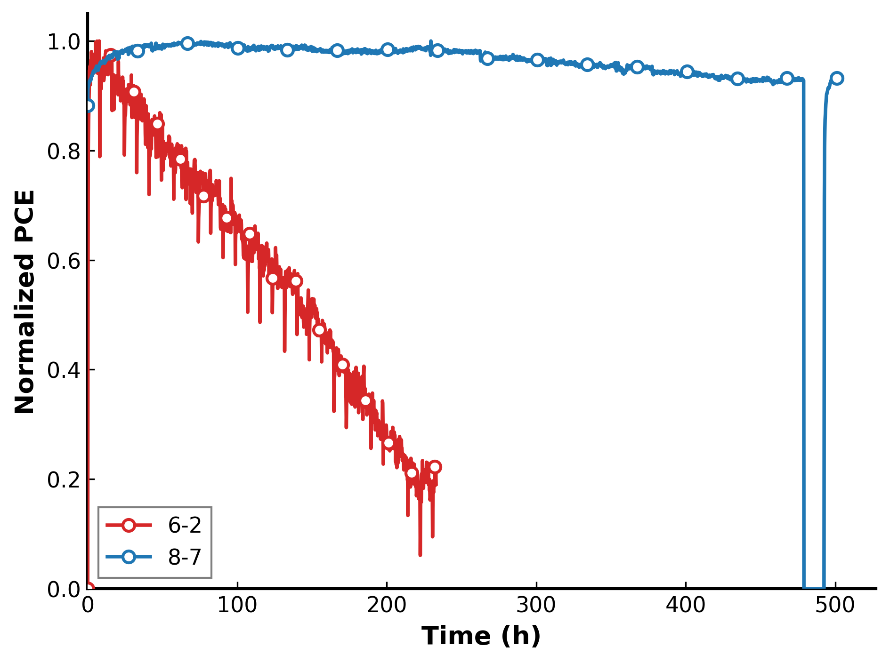
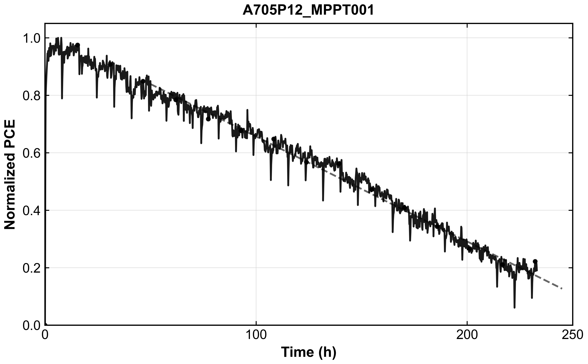
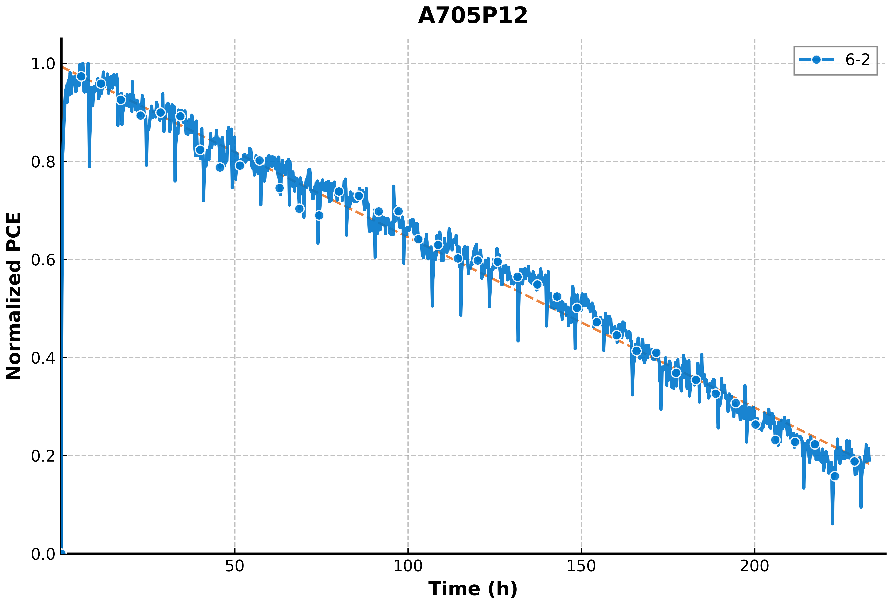
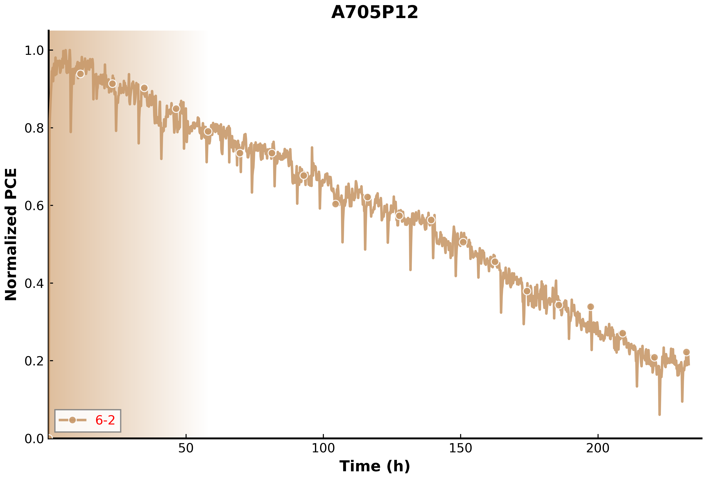

# 钙钛矿 MPPT 曲线视觉学习数据集

[English](README.md) | [简体中文](README_CN.md)

本仓库将 **30 组钙钛矿 MPPT 器件实验序列**绘制为 **102 张高分辨率图像**，用于视觉识别研究。四类图像分别呈现辅助线、线条重叠、有色背景和同图多曲线。

每张生成图都与处理后的测量数据和绘图代码对应，可用于曲线追踪与科研图理解研究。



## 研究目标

核心任务是在复杂图形元素中识别并追踪**目标衰减曲线**，避免将辅助线或其他数据系列误认为目标曲线。数据集围绕四类常见问题设计：

1. **存在辅助线：** 网格线、参考线或拟合趋势线与目标曲线同时出现。
2. **目标曲线与辅助线重叠：** 交叉或共线片段使曲线身份难以判断。
3. **曲线背景存在颜色差异：** 渐变或有色背景使仅靠颜色识别曲线不可靠。
4. **一图包含多种曲线：** 两条或三条数据曲线交叉、部分重叠，需要分别追踪。

这四类图由钙钛矿 MPPT 时间序列控制性绘制而成，可用于研究目标曲线识别、复杂区域追踪和衰减曲线形状理解。

**测量含义。** 每个器件的 `Pmax` 序列均按自身最小值与最大值缩放到 0–1，保留曲线形状并消去绝对衰减幅度。纵轴 `Normalized PCE` 表示这一缩放值；保持率、T80 和寿命分析需要原始未缩放的测量数据。

## 从数据到图像

```text
钙钛矿 MPPT 实验数据
        ↓
计算经过时间并对 Pmax 做最小值—最大值缩放
        ↓
处理后的曲线 CSV
        ↓
assistline / assistline_overlap / colour / multi
        ↓
视觉学习图像数据集
```

数据集包含：

- 30 组已处理的钙钛矿器件数据；
- 73,242 个经最小值—最大值缩放的时间序列数据点；
- 90 张单器件曲线图，分为三类；
- 12 张多器件曲线图，构成第四类；
- 共 102 张高分辨率 PNG 图像；
- 数据预处理及绘图脚本。

## 四类图形及其识别难点

| 类别 | 图像数 | 识别难点 | 图形内容 |
| --- | ---: | --- | --- |
| `figure/assistline/` | 30 | 存在辅助元素时识别目标曲线 | 单器件曲线、采样标记、参考网格和线性拟合线 |
| `figure/assistline_overlap/` | 30 | 在与辅助线重叠或交叉处追踪目标曲线 | 单器件曲线、每个坐标刻度处的灰色虚线参考线，以及与曲线重叠的虚线线性拟合趋势线 |
| `figure/colour/` | 30 | 在非均匀有色背景中识别曲线 | 单器件曲线、实心与空心交替的标记，以及覆盖图左侧的棕白渐变带（宽度取 80 h 与横轴范围 22% 中的较小者） |
| `figure/multi/` | 12 | 在交叉和局部重叠处区分多条曲线 | 同一图中的两条或三条器件曲线 |

前三类展示单条实验数据系列的不同绘图形式；`multi` 类将选定器件放在同一图中。四类图引入常见的视觉歧义，同时保留底层 MPPT 曲线的变化行为。

## 仓库结构

```text
.
├── code/
│   ├── preprocess.py           # 原始 MPPT 数据预处理
│   ├── assistline.py           # 单器件曲线、网格及线性拟合线
│   ├── assistline_overlap.py   # 单器件曲线与虚线参考线、趋势线重叠
│   ├── colour.py               # 局部渐变背景上的单器件曲线
│   ├── multi-2.py              # 双器件对比图
│   └── multi-3.py              # 双器件或三器件对比图
├── data_csv/                   # 30 份处理后的 CSV
├── figure/
│   ├── assistline/
│   ├── assistline_overlap/
│   ├── colour/
│   └── multi/
├── README.md                   # English
└── README_CN.md                # 简体中文
```

## 数据格式

每个处理后的 CSV 文件包含以下列：

| 列名 | 说明 |
| --- | --- |
| `ID` | 器件或测量标识 |
| `Figure` | 图号 |
| `Sub-figure` | 子图标签 |
| `Value_x` | 以换行符分隔的经过时间，单位为小时 |
| `Value_y` | 以换行符分隔、按器件做最小值—最大值缩放到 0–1 的 `Pmax` 数值（只保留形状，见上文说明） |
| `Legend` | 器件结构或数据集图例标签 |
| `X-label` | 横轴标签 |
| `Y-label` | 纵轴标签 |
| `Title` | 可选标题 |

数据集的 30 个器件文件共包含 73,242 个时间序列数据点，测量时长约为 233 至 624 小时。`data_csv/` 中的器件标识可与单器件图像目录中同名的图像对应。

## 预期用途与当前范围

- 开发在复杂科研图中定位并追踪目标曲线的视觉学习任务。
- 研究辅助线、曲线重叠、背景颜色变化和多曲线交叉对识别的影响。
- 为未来训练和评估面向钙钛矿衰减曲线的专用多模态大语言模型／视觉语言模型提供数据基础。
- 比较单器件和多器件 MPPT 曲线的衰减形状（由于最小值—最大值缩放，不能比较衰减幅度）。

本仓库提供图像、处理后的测量数据和绘图脚本。开展模型训练时，可增加针对具体任务的标注，并按器件 ID 划分训练、验证和测试集，使同一实验曲线的不同绘图版本处于同一数据分区。

## 环境依赖

- Python 3.9 或更高版本
- NumPy
- pandas
- Matplotlib

建议在虚拟环境中安装：

```bash
python3 -m venv .venv
source .venv/bin/activate
python -m pip install --upgrade pip
python -m pip install numpy pandas matplotlib
```

Windows 下使用 `.venv\Scripts\activate` 激活虚拟环境。

## 路径配置

脚本中的 `BASE_DIR` 常量沿用了原本的本地工作路径。运行前，请将它改为克隆仓库的绝对路径：

```python
BASE_DIR = "/absolute/path/to/perovskite-mppt-curve-visualization-dataset"
```

各脚本相对于 `BASE_DIR` 的读写位置如下：

| 脚本 | 读取 | 写出 |
| --- | --- | --- |
| `preprocess.py` | `原始数据/`、`器件结构.csv` | `<器件文件夹>/metadata_pv.csv`（直接位于 `BASE_DIR` 下） |
| `assistline.py` | `data/<器件>/metadata_pv.csv` | `pub_style/<器件>.png` |
| `assistline_overlap.py` | `data/<器件>/metadata_pv.csv` | `assistline_overlap/<器件>.png` |
| `colour.py` | `data/<器件>/metadata_pv.csv` | `pub_style_all/<器件>.png` |
| `multi-2.py`、`multi-3.py` | `data_csv/<器件>.csv` | `multi_csv/<器件1>_<器件2>[_<器件3>].png` |

注意 `preprocess.py` 的输出比单器件脚本的读取位置高一层，绘图前需把器件文件夹移入 `data/`（或修改路径）。整理仓库时，各输出文件夹已改名为 `figure/` 下的子文件夹。

嵌套的 `data/` 目录和原始仪器导出文件未包含在仓库中。`data_csv/` 中每个文件的列与 `metadata_pv.csv` 相同，因此可以把 `data_csv/<器件>.csv` 复制为 `data/<器件>/metadata_pv.csv` 来重建单器件输入结构。

## 绘图流程

### 生成双器件对比图

按需要编辑 `code/multi-2.py` 中的 `PAIRS` 和 `X_MAX_MAP`，然后运行：

```bash
python code/multi-2.py
```

`PAIRS` 中的名称应与 `data_csv/` 下的文件名一致，但不包含 `.csv` 扩展名。当前提交的列表生成 8 张图。

### 生成双器件或三器件对比图

编辑 `code/multi-3.py` 中的 `PAIRS`，然后运行：

```bash
python code/multi-3.py
```

该脚本支持包含两个或三个器件名称的元组，曲线使用红、蓝、绿三种颜色。当前提交的列表生成 8 张图；其中前五组与 `multi-2.py` 相同且文件名一致，因此这五张图以最后运行的脚本为准。

两个脚本当前的 `PAIRS` 合起来生成 11 张不同的图。`figure/multi/AY04P29_P101P04.png` 不在任何一个列表中，需要加入 `PAIRS` 才能重新生成。

### 运行存档的预处理流程

`code/preprocess.py` 依赖仓库中未包含的两个上游输入：

- `原始数据/`：原始 MPPT 导出数据，可以是带时间戳列的常规 CSV 或受支持的仪器格式 CSV；
- `器件结构.csv`：器件 ID 与图例标签之间的映射。

脚本以第一个时间戳为起点计算经过时间，对 `Pmax` 做最小值—最大值缩放，将纵轴标签设为 `Normalized PCE`，并写出绘图元数据。处理新数据前需检查脚本中的输入和输出路径。

### 生成单器件曲线图

准备好 `data/<device>/metadata_pv.csv` 结构并更新 `BASE_DIR` 后，运行相应脚本：

```bash
python code/assistline.py
python code/assistline_overlap.py
python code/colour.py
```

仓库中 `figure/assistline/` 下的文件带有 `_Control_PCE` 后缀（如 `A705P12_MPPT001_Control_PCE.png`），来自早期版本的 `assistline.py`；当前脚本输出的文件名为 `<器件>.png`。

## 四类图像示例

| `assistline` | `assistline_overlap` |
| --- | --- |
|  |  |
| `colour` | `multi` |
|  |  |

## 可复现性与数据集说明

- 绘图脚本使用 Matplotlib 的 `Agg` 后端，无需图形界面即可运行。
- 部分样式请求 Arial 字体；若系统没有 Arial，Matplotlib 会回退到可用的无衬线字体。
- 绘图脚本按经过时间排序，并按 `Value_x` 与 `Value_y` 的共同长度配对。
- 预处理脚本使用最小值—最大值缩放：`(Pmax - min(Pmax)) / (max(Pmax) - min(Pmax))`，不保留绝对功率及相对初始值的保持率。
- 图像分辨率较高，批量处理时可能需要更多内存。
- 同一实验曲线可能对应多种图形样式；设计机器学习数据划分时应将它们视为关联样本。
- 生成的图像用于视觉学习和科研图像理解研究，不是器件寿命认证结果，也不是直接从论文中提取的图像。

## 许可证与数据使用

代码与实验数据的再使用条款仍在确定中。再次分发测量数据或生成图时，应核对原始数据的使用权。
